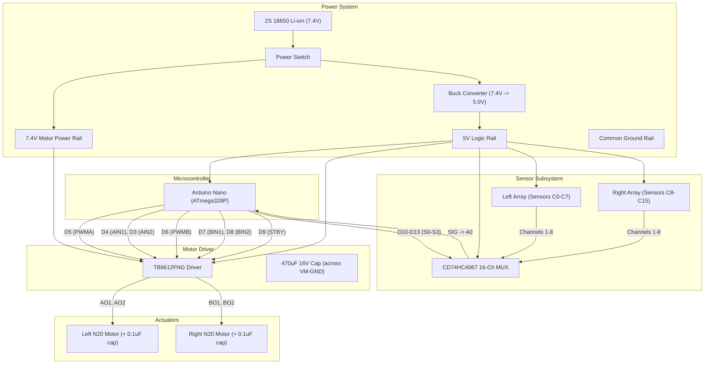

# Pathfinder LFR 🚀
### 16-Channel High-Speed Differential Line Follower Robot

Autonomous, high-performance Line Follower Robot (LFR) designed for competition tracks featuring 90° corners, acute zig-zags, loops, crossings, and high-speed straights.

Powered by an **Arduino Nano (ATmega328P)**, **TB6612FNG** dual H-bridge motor driver, **CD74HC4067** 16-channel analog multiplexer, and a custom **forward-pointing V-shaped (arrowhead) 16-sensor IR array**.

---

## 🗺 System Schematic & Circuit Diagram



---

## 🛠 Hardware Specifications

| Component | Specification |
| :--- | :--- |
| **Microcontroller** | Arduino Nano (ATmega328P Old Bootloader, 16 MHz) |
| **Motor Driver** | Toshiba TB6612FNG Dual H-Bridge (1.2A continuous, 3.2A peak) |
| **Motors** | 2× N20 Micro Metal Gearmotors (6V / 12V, 600–1000 RPM) |
| **Sensor Multiplexer** | CD74HC4067 16-Channel Analog/Digital Multiplexer |
| **Sensor Array** | 2× 8-Channel IR Reflectance Arrays (16 photodiodes total) |
| **Power Supply** | 2S 18650 Li-ion battery pack (7.4V nominal, 8.4V peak) |
| **Regulator** | Step-down Buck Converter tuned to 5.0V |
| **Decoupling** | 470µF electrolytic across `VM-GND`; 0.1µF ceramics across motor lugs |

---

## 📐 Chassis & Sensor Geometry

The sensor array is arranged in a forward-pointing arrowhead (`^`) V-shape with an inner angle of **65°–70°**:

```text
                       ▲ FORWARD
                       │
                     [Apex]
                    C7    C8         <-- 20 cm from drive wheel axle
                  C6        C9
                C5            C10
              C4                C11
            C3                    C12
          C2                        C13
        C1                            C14
      C0                                C15   <-- 15 cm from drive wheel axle
   [Left Wing]                       [Right Wing]
        │                                 │
        └────────── 38 cm span ───────────┘
                       │
               ┌───────┴───────┐
             [Left]         [Right]
             Wheel           Wheel
               └───────┬───────┘
                 [Drive Axle]
```

- **Apex (C7, C8):** 20 cm forward of wheel axle. First to track incoming lines.
- **Wingtips (C0, C15):** 15 cm forward of wheel axle (swept back 5 cm relative to apex).
- **Sensor Weights (tenths-of-mm from centerline):**
  - Left Wing: `C0: -188, C1: -161, C2: -134, C3: -107, C4: -81, C5: -54, C6: -27, C7: -5`
  - Right Wing: `C8: +5, C9: +27, C10: +54, C11: +81, C12: +107, C13: +134, C14: +161, C15: +188`

---

## ⚡ Pinout & Wiring Map

### 1. TB6612FNG Motor Driver
| Nano Pin | TB6612 Pin | Function |
| :--- | :--- | :--- |
| **D5** | `PWMA` | Left Motor Speed (PWM, Timer0) |
| **D4** | `AIN1` | Left Motor Direction A |
| **D3** | `AIN2` | Left Motor Direction B |
| **D6** | `PWMB` | Right Motor Speed (PWM, Timer0) |
| **D7** | `BIN1` | Right Motor Direction A |
| **D8** | `BIN2` | Right Motor Direction B |
| **D9** | `STBY` | Standby enable (HIGH = active) |
| — | `VM` | Battery Raw Power (7.4V) |
| — | `VCC` | 5V Regulated Logic Power |
| — | `GND` | Common Ground Rail |

### 2. CD74HC4067 16-Channel MUX
| Nano Pin | MUX Pin | Function |
| :--- | :--- | :--- |
| **D10** | `S0` | Channel Select Bit 0 |
| **D11** | `S1` | Channel Select Bit 1 |
| **D12** | `S2` | Channel Select Bit 2 |
| **D13** | `S3` | Channel Select Bit 3 |
| **A0** | `SIG` | Multiplexed Sensor Analog Signal In |
| **GND** | `EN` | Enable (tied to GND = active) |
| — | `C0–C7` | Left IR Array Channels 1–8 |
| — | `C8–C15` | Right IR Array Channels 1–8 |

---

## 🧠 Control Algorithms & Firmware Architecture

### 1. Dynamic Base Speed (Corner Deceleration)
On straights, the robot cruises at `baseSpeed` (95 PWM). As tracking error increases into curves and sharp vertices, forward speed smoothly bleeds down to **0 PWM**:
$$\text{currentBase} = \max(0, \text{baseSpeed} - (|error| - 20) \times 1.5)$$
At $|error| > 75$, forward drive stops completely. Outer wheel drives forward (+180) and inner wheel reverses (-180), executing a **pure zero-radius tank pivot** on the wheel axle without flinging the 20 cm nose into white space.

### 2. Pololu-Style Position Memory
When the line is lost (`active == 0`), naive weighted averages return 0 (falsely signaling "centered"). Pathfinder retains the extreme edge ($\pm 188$) based on `lastPos`:
- Left wing loss $\to -188$
- Right wing loss $\to +188$

### 3. Atomic Lost-Line Recovery
Replaces sluggish multi-phase timers with a fast, deterministic loop:
1. **Pull-back pulse (45 ms):** Reverses straight back ~2 cm to pull the 20 cm apex back over the corner vertex.
2. **Blocking in-place spin:** `while (readSensors() == 0)` spins at full recovery torque (`turnSpeed = 180`) in `latchedTurnDir`.
3. **Corner Alignment Lock:** Continues pivoting until the line swings within the center zone ($|pos| \le 55$). Heading fully aligns with track before forward drive resumes. Zero boundary jitter.

### 4. Wing-Gated Cross-Junction Pass-Through
Grid crossings activate both outer wings simultaneously:
$$\text{active} \ge 12 \quad \text{AND} \quad \text{leftWingActive} \quad \text{AND} \quad \text{rightWingActive}$$
Prevents perpendicular intersections from triggering false turns.

### 5. Live USB Serial Tuning
Adjust PID, speeds, and motor trims on the fly over Serial Monitor (115200 baud) without recompiling:
```text
p 0.85     -> Set Kp
d 2.2      -> Set Kd
i 0.0      -> Set Ki
s 100      -> Set baseSpeed
t 190      -> Set turnSpeed
l 0.95     -> Set left motor trim multiplier
r 1.0      -> Set right motor trim multiplier
?          -> Print active configuration
```

---

## 🚦 Calibration & Race Start Sequence

1. **Power-On:** Robot beeps motors in a 5-second countdown.
2. **Auto-Calibration Sweep:** Robot sweeps left and right across the track for 4 seconds, recording per-sensor minimum (white floor) and maximum (black line) ADC values. Features 40 ms anti-brownout deadbands between reversals.
3. **Race Launch:** 4-second audible countdown to position on start line $\to$ GO!

---

## 💻 Build & Upload Instructions

### Prerequisites
Install [arduino-cli](https://arduino.github.io/arduino-cli/latest/) and AVR core:
```bash
arduino-cli core install arduino:avr
```

### Compile
```bash
arduino-cli compile --fqbn arduino:avr:nano:cpu=atmega328old .
```

### Upload
```bash
arduino-cli upload -p /dev/ttyUSB0 --fqbn arduino:avr:nano:cpu=atmega328old .
```

---

## 📜 License
MIT License. Built for competition robotics.
