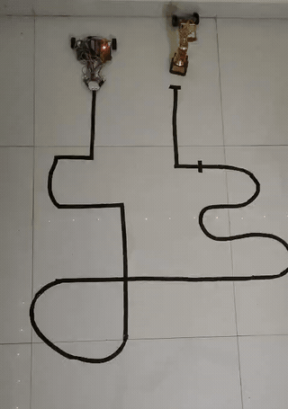
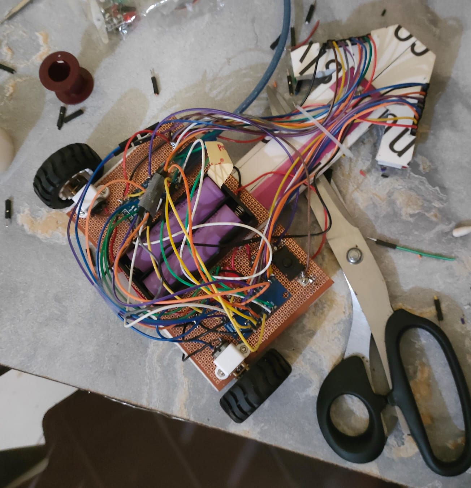
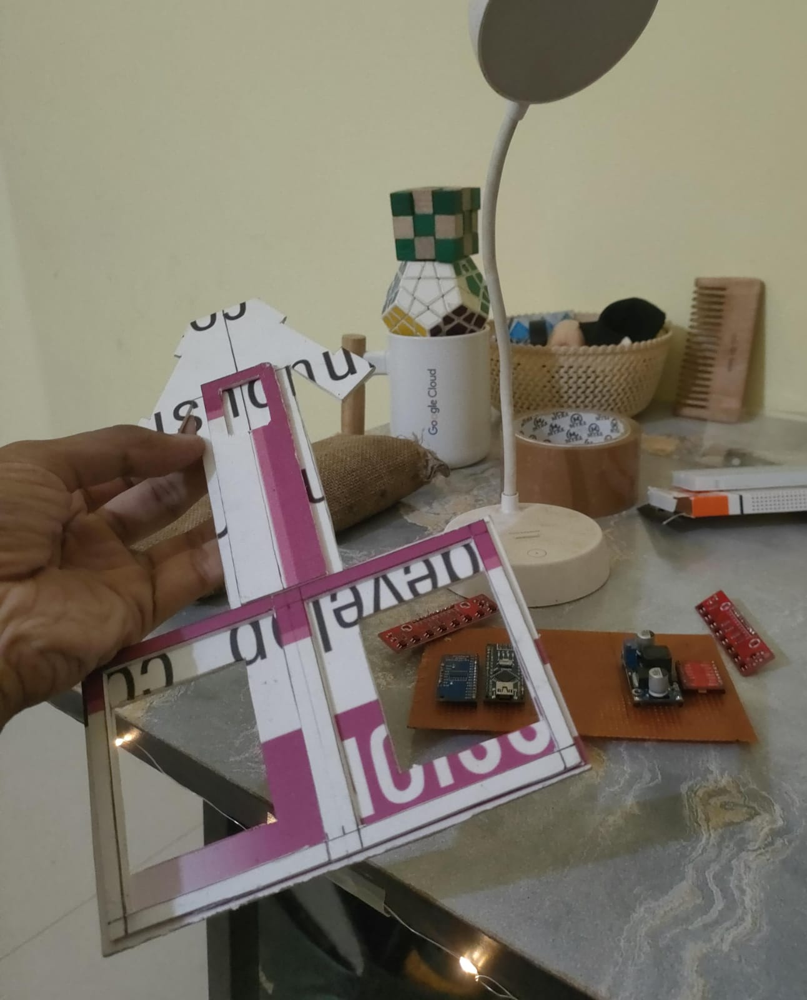
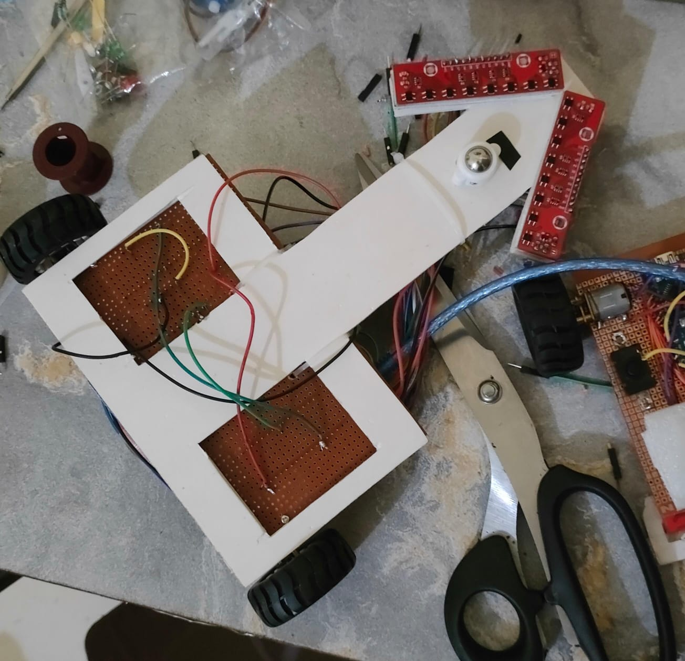
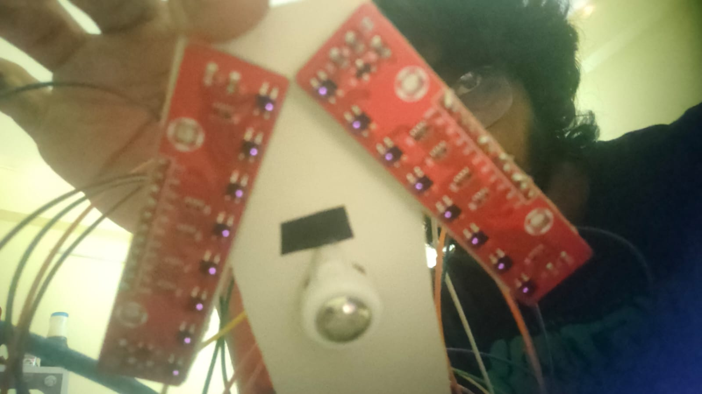
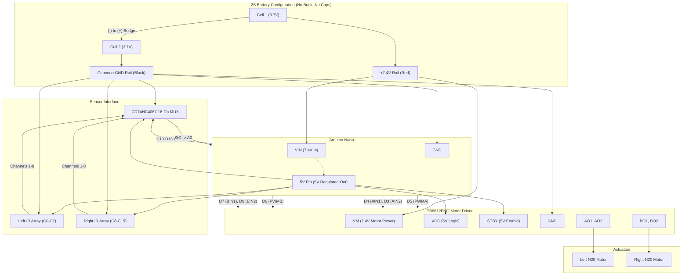

## pathfinder

line follower robot i made for a college event.

first time making one of these, i learnt alot while designing and building this, lots of mistakes were made too which helped me learn even more stuff.

uses simple PID, with a few tweaks.

## components

- **Arduino Nano** (ATmega328P, 16 MHz) — main microcontroller
- **TB6612FNG** — dual H-bridge motor driver (1.2A continuous / 3.2A peak)
- **2× N20 Micro Metal Gearmotors** — high-torque differential drive
- **2× Rubber Grip Wheels** (matching N20 3mm D-shaft)
- **CD74HC4067** — 16-channel analog/digital multiplexer breakout board
- **2× 8-Channel IR Reflectance Arrays** — 16 photodiode pairs total in forward V-array
- **2× 18650 Li-ion Cells** (7.4V nominal 2S configuration) + 2S battery holder
- **Ball Caster Wheel** — low-friction chassis balance
- **Sunboard Chassis** — mounts motors, electronics, and 65°–70° V-sensor wing
- Perfboard, header pins, standoffs, and wiring harness

## process

built in 36 hours, the design was not much thought about, mistakes were made, but were also learnt from.

the all nighter pulled for this was genuinely fun though, just me in my room with my silly tools, didnt even realise how quickly 12 hours passed by, wish i had more time outside college to work on stuff like this without compromising sleep and gains.

## how it looks
<div align="center">


*autonomous track run speed demo*


*fully assembled and wired robot*


*hand-cut sunboard chassis frame (dick shaped)*


*underside view with caster wheel*


*active 16-channel IR sensor wing*

</div>

## schema

#### 1. power architecture (2S 18650 series)

```
[Cell 1: 3.7V]               [Cell 2: 3.7V]
(+) ──────── (-) ─────────── (+) ──────── (-)
 │                Bridge                   │
 │               (Series)                  │
 ▼                                         ▼
+7.4V (Red Wire)                         GND / 0V (Black Wire)
 │                                         │
 ├─────────────────────────────────────────┼───────────────────────────┐
 │                                         │                           │
 ▼                                         ▼                           ▼
TB6612 VM (Motor Power)               Common GND Rail               Nano GND
Nano VIN  (Feeds Onboard LDO)              │                        TB6612 GND
 │                                         ├──────────────────────> MUX GND & EN
 ▼                                         └──────────────────────> 2× IR Arrays GND
[Nano 5V Pin] (5V Logic Output)
 │
 ├──> TB6612 VCC (Logic Power)
 ├──> TB6612 STBY (Enable Driver)
 ├──> CD74HC4067 VDD (MUX Logic)
 ├──> IR Array 1 VCC
 └──> IR Array 2 VCC
```

#### 2. interactive system circuit diagram



#### complete pinout table

| Source Device & Pin | Destination Device & Pin | Voltage Level | Function / Description |
| :--- | :--- | :--- | :--- |
| **Battery (+) Red** | **Nano `VIN`** | **7.4V** | Battery raw power to internal 5V regulator |
| **Battery (+) Red** | **TB6612 `VM`** | **7.4V** | Raw battery voltage for driving N20 motors |
| **Battery (-) Black** | **Common GND Rail** | **0V** | Shared ground for all components |
| **Nano `5V` (Output)** | **TB6612 `VCC`** | **5.0V** | Logic power for motor driver |
| **Nano `5V` (Output)** | **TB6612 `STBY`** | **5.0V** | Hardware standby tie-HIGH (driver active) |
| **Nano `5V` (Output)** | **CD74HC4067 `VDD`** | **5.0V** | Logic power for multiplexer IC |
| **Nano `5V` (Output)** | **IR Array 1 & 2 `VCC`** | **5.0V** | Power for IR emitter LEDs and comparators |
| **Nano `GND`** | **Common GND Rail** | **0V** | Microcontroller reference ground |
| **TB6612 `GND`** | **Common GND Rail** | **0V** | Motor driver reference ground |
| **CD74HC4067 `GND`** | **Common GND Rail** | **0V** | Multiplexer ground |
| **CD74HC4067 `EN`** | **Common GND Rail** | **0V** | Active-low enable tied to GND (always active) |
| **IR Array 1 & 2 `GND`**| **Common GND Rail** | **0V** | Sensor boards ground |
| **Nano `D3`** | **TB6612 `AIN2`** | 5V Logic | Left motor direction B |
| **Nano `D4`** | **TB6612 `AIN1`** | 5V Logic | Left motor direction A |
| **Nano `D5`** | **TB6612 `PWMA`** | 5V PWM | Left motor speed control (Timer0) |
| **Nano `D6`** | **TB6612 `PWMB`** | 5V PWM | Right motor speed control (Timer0) |
| **Nano `D7`** | **TB6612 `BIN1`** | 5V Logic | Right motor direction A |
| **Nano `D8`** | **TB6612 `BIN2`** | 5V Logic | Right motor direction B |
| **Nano `D10`** | **CD74HC4067 `S0`** | 5V Logic | MUX address bit 0 |
| **Nano `D11`** | **CD74HC4067 `S1`** | 5V Logic | MUX address bit 1 |
| **Nano `D12`** | **CD74HC4067 `S2`** | 5V Logic | MUX address bit 2 |
| **Nano `D13`** | **CD74HC4067 `S3`** | 5V Logic | MUX address bit 3 |
| **Nano `A0`** | **CD74HC4067 `SIG`** | 0–5V Analog | Selected sensor analog input |
| **TB6612 `AO1, AO2`** | **Left N20 Motor** | $\pm 7.4\text{V}$ | Left drive wheel output |
| **TB6612 `BO1, BO2`** | **Right N20 Motor** | $\pm 7.4\text{V}$ | Right drive wheel output |
| **CD74HC4067 `C0–C7`** | **IR Array 1 (Out 1–8)** | Analog | Left wing sensor channels (C0 = outermost left) |
| **CD74HC4067 `C8–C15`**| **IR Array 2 (Out 1–8)** | Analog | Right wing sensor channels (C15 = outermost right) |


## mistakes i made
- not properly taking out enough time for this project
- designing the chassis too fast, without considering the total weight, CG, torque needed to turn the whole robot, etc
- LOTS AND LOTS of solder bridges, learnt how to clear them out
- bad tuning tests
- not testing on a proper path before the contest
- plugging in the serial usb without taking out the batteries from the robot, causing my laptop to crash due to polyfuse tripping in motherboard to prevent fire
- not measuring the angle of the IR sensor arrays properly
- could have used a better obtuse angle for the IR sensor arrays
- too much weight on the robot, needing higher torque to move and turn
- messy wirings and soldering

overall, ill try to learn and improve as much as i can from this small weekend project, and hopefully it will help me in my future robotics projects.
